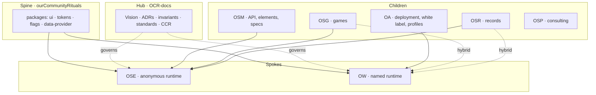

# Ecosystem layers: spine, hub, spokes, children

> **Status: draft, 2026-10-04, PO terminology.** The org-level source of truth is `OCR-docs/docs/OCR_VISION.md`. This page explains how the layers fit for someone working in OSE, and should be promoted to OCR-docs if the PO accepts it. The layer names below are the PO's.

## The four layers

| Layer        | Repo (GitHub org `ourCommunityRituals`)                                                                                | What it is                                                   | Holds                                                                                        |
| ------------ | ---------------------------------------------------------------------------------------------------------------------- | ------------------------------------------------------------ | -------------------------------------------------------------------------------------------- |
| **Spine**    | `ourCommunityRituals`                                                                                                  | The shared engineering base. A pnpm workspace                | `packages/ui`, `tokens`, `flags`, `data-provider`, `runner-fleet`; shared CI                 |
| **Hub**      | `OCR-docs`                                                                                                             | The org brain: governance, vision, standards, skills, status | `OCR_VISION.md`, ADRs, invariants, CCR protocol, `.ocr-standards`                            |
| **Spokes**   | `ourSharedEvents` (OSE), `ourWKRP` (OW)                                                                                | The two runtimes with running code and their own databases   | Cloudflare Workers, D1, tests, templates                                                     |
| **Children** | `ourSharedMagnets` (OSM), `ourAirwaves` (OA), `ourSharedGames` (OSG), `ourSharedRecords` (OSR), `ourSharedPulse` (OSP) | Products and layers that build on the spokes                 | Each has `CLAUDE.md`, `README.md`, `SKILL.md` (docs-as-code) and its own Linear team or repo |

All of these are present in the infrastructure: each has a GitHub repo, and the spokes and most children have a Linear team (OSE, OW, OCR-doc, OSG, OSR, OSM).

## How they connect



- **Spine to spokes:** OSE and OW consume the spine's packages. In OSE the pin is `.ocr-hub-ref` (currently the commit that holds the uniform palette). CI stages the spine at that exact commit.
- **Hub to everything:** governance flows down as standards, invariants and skills. Where an invariant is in code, the code is the source of truth and the hub mirrors it.
- **Spoke to spoke:** none. OSE and OW share architecture and brand, not databases. The only crossing is a link a person chooses to share.
- **Children to spokes:** OSM supplies the back (API, elements, specs) and provisions the anonymous class. OA stands up the front and provisions the named class. OSG and OSR inherit OSE's anonymous architecture and are hybrid-capable with OW.

## How it stays true: the sync (reconciliation) loop

Every layer is kept honest by one existing process: the **reconciliation loop**, everyday name **sync** (`/sync`). It is defined once in `OCR_STANDARD_reconciliationLoop` (hub: `OCR-docs/docs/standards/`, propagated to each repo's `.ocr-standards/standards/`). This page does not restate it. It shows where each layer sits in it.

The loop is a fixed cycle of named rungs:

```
Shared Brain → Invariant → Code → CI/CD → Test Pyramid → Results → Reporting → ↺ Shared Brain
```

| Rung               | In this ecosystem                                                                           |
| ------------------ | ------------------------------------------------------------------------------------------- |
| Shared Brain       | The hub, `OCR-docs` (vision, ADRs, standards)                                               |
| Invariant          | The brain's machine-readable rules; in OSE they run as gates in `tests/e2e/0-architecture/` |
| Code               | The spokes OSE and OW, plus the spine's packages; the children build on them                |
| CI/CD              | The staging chain (see [STAGING.md](../deployment/STAGING.md))                              |
| Test Pyramid       | Security, lint, contract, unit, integration, API, E2E, per runtime                          |
| Results, Reporting | Reds and greens, then the readout that loops back to the brain                              |

Three things keep it in sync (`OCR_STANDARD_orgBrainSync` and the loop standard):

1. **Push down:** a change to standards in the hub opens PRs in every product repo, including the children. Humans merge.
2. **Audit:** a nightly read-only check flags a repo with no `CLAUDE.md`, `README.md` or `SKILL.md`, or standards that have drifted.
3. **Catch up:** an on-demand `/sync` pass reconciles three surfaces, **Linear** (intent), **Code** (reality) and **Brain plus memory** (doctrine), in the order **brain, then base (OSE), then named (OW), then the children**.

Rules that matter to anyone changing code:

- **Evidence order:** code, tests and CI first; then the active ADR; then board state. A board that disagrees with the code is drift, not a reason to reopen work.
- **Reconcile in the same PR:** read the relevant ADR, check it against the code, and update or mark it superseded in the same change (`docs/adr/ADR-RECONCILIATION-PROCESS.md`, with its PR checklist).
- **Verify first:** a Done flip cites `sha`, `ancestor_verified` and `pr`, and `verify_reconcile_comment.py` re-runs the ancestor check itself rather than trusting the comment.
- **Spoke ahead of the brain:** if a shared truth first works in a spoke, promote it to the hub first, then re-propagate.
- **Keep the brain light:** durable rules and pointers only. Run logs go to Linear, not new files.
- **The agent never controls authorization.** It reads git and proposes. Humans merge and deploy.

Two caveats from the sources themselves:

- The per-run readout is currently narrated, not derived from signals, except for the tickets row (tracked as OCR-146). Treat it as a lead to verify.
- The sync standard's third mechanism names the Bloodraven runner. OSE `CLAUDE.md` records that runner as retired on 2026-09-02, and the loop is run on demand.

A worked example: the front-end check against Linear on 2026-10-04 was a Linear-to-code pass. Its first verdict on OSE-1566 ("stale") was wrong, because a search of the code found the fix while the ticket's staging measurement showed it failing. That is the case verify-first exists for.

The existing standards call OSG, OSM, OSR, OSP and OA "spokes". This page calls them children, as the PO does, so OSE and OW are the spokes.

## The word "hub" has two uses

ADR-008 (hub ADR, Proposed) calls the `ourCommunityRituals` repo "the hub" because it holds the shared packages. The PO calls that repo the **spine** and uses **hub** for `OCR-docs`. This page follows the PO's words. When you read ADR-008 or `.ocr-hub-ref`, "hub" there means the spine.

## Where things live

| I need to…                                                | Go to                                                                 |
| --------------------------------------------------------- | --------------------------------------------------------------------- |
| Change colours, type or shared components                 | Spine: `packages/ui`, then bump the pin in each spoke                 |
| Read or change the org vision, an invariant or a standard | Hub: `OCR-docs`                                                       |
| Change an anonymous-event behaviour                       | OSE                                                                   |
| Change a named-profile behaviour                          | OW                                                                    |
| Brand a client or run a season                            | OSM (staff-run, from Bruno)                                           |
| Give a person a profile page                              | OA, served by OW                                                      |
| Look up whether a story is Done                           | OSE `AGENTS.md`, Definition of Done: merged, then staging chain green |

## What stays true

- OSE and OW stay separate runtimes with their own invariants, code and tests. Nothing here merges them.
- Children are not folded away. Fewer pipelines are reached by sharing the spine's CI bracket, not by removing repos.
- Public naming is one system; these layers are internal. See `docs/positioning/BRAND-INFRASTRUCTURE-MAPPING-2026-10-04.md`.

## Related

- The sync process: `.ocr-standards/standards/OCR_STANDARD_reconciliationLoop.md` and `OCR_STANDARD_orgBrainSync.md` (source in `OCR-docs/docs/standards/`)
- ADR reconciliation and PR checklist: [docs/adr/ADR-RECONCILIATION-PROCESS.md](../adr/ADR-RECONCILIATION-PROCESS.md)
- Linear against code, worked example: [docs/audits/LINEAR_BACKLOG_RECONCILIATION_2026-09-22.md](../audits/LINEAR_BACKLOG_RECONCILIATION_2026-09-22.md)
- Staging: [docs/deployment/STAGING.md](../deployment/STAGING.md)
- ADR-008 (consolidation) and ADR-009 (composition plane): `OCR-docs/docs/adr/`
